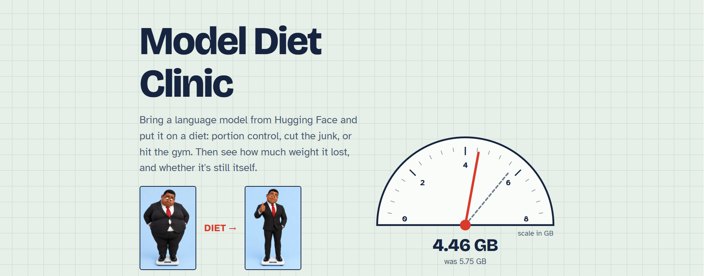
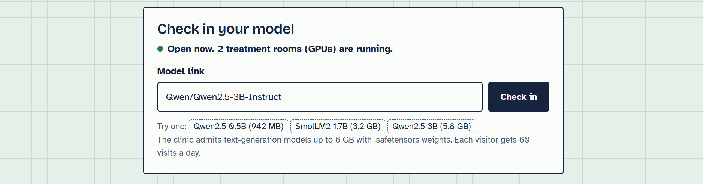
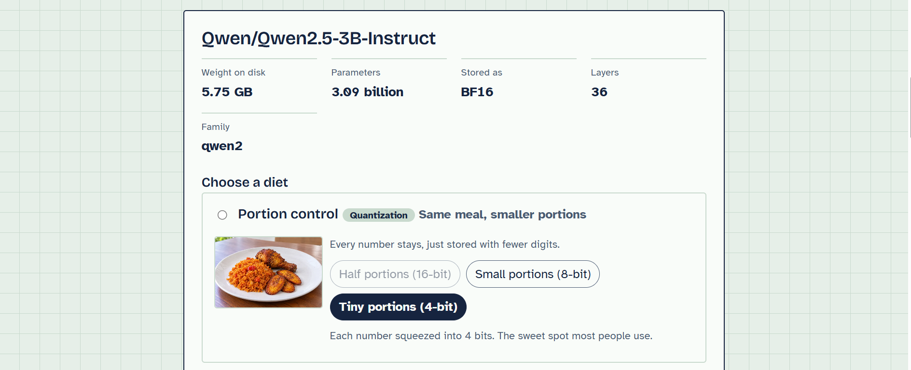
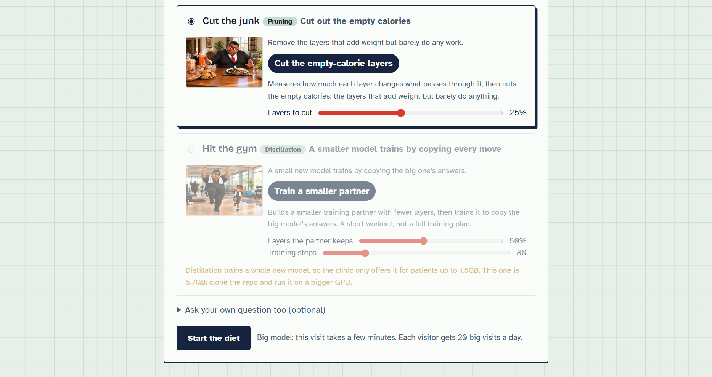
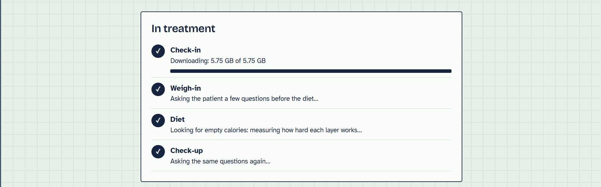
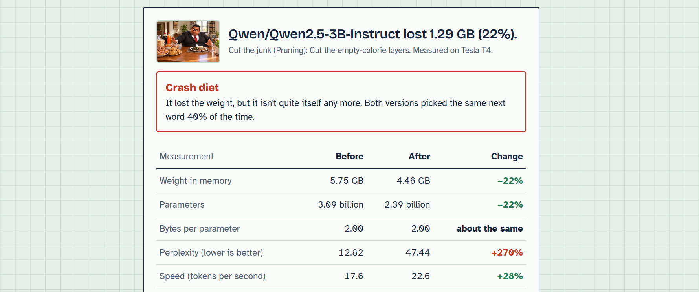
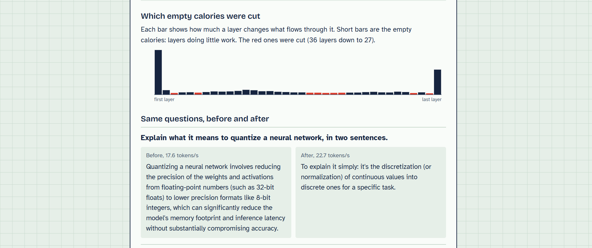
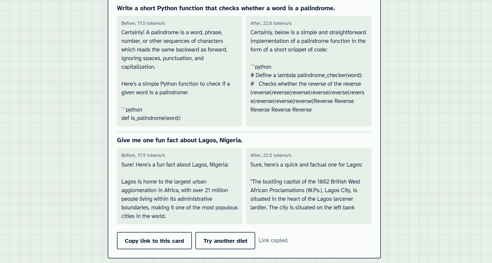
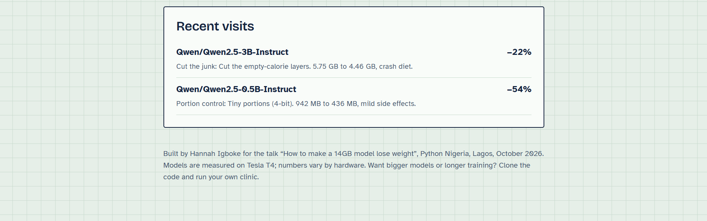

# Model Diet Clinic

**How to make a 14GB model lose weight**

Paste a link to any text-generation model on Hugging Face, pick a diet, and the clinic weighs the model, puts it on the diet, weighs it again, and checks whether it's still itself. You get a card with:

- **Weight**: memory footprint before and after, parameters, bytes per parameter
- **Health**: perplexity on held-out text, how often the dieted model picks the same next word as the original, and KL divergence between the two
- **Fitness**: generation speed in tokens per second
- **Personality**: the same questions answered by both versions, side by side
- A shareable link to the card, and a list of recent visits

Built for a lightning talk at the Python Nigeria meetup, Lagos, 24 October 2026.

**Try it:** [hannahigboke.github.io/model-diet-clinic](https://hannahigboke.github.io/model-diet-clinic/) (the clinic runs on a borrowed GPU, so it's only open at certain times; weigh-in cards from earlier visits stay viewable).



## See it in action

Here's one real visit: `Qwen/Qwen2.5-3B-Instruct` (5.75 GB) on the *Cut the junk* diet, on a free Kaggle Tesla T4.

**1. Check in your model.** Paste a Hugging Face link or name, or pick one of the examples.



**2. The clinic weighs it** (size on disk, parameters, number format, layers) **and you choose a diet.**





**3. Treatment, live.** Download, weigh-in, diet and check-up, each step streamed as it happens.



**4. The weigh-in card.** How much weight it lost, and whether it's still itself. This one lost 22% and was faster, but cutting a quarter of its layers was a *crash diet*: it only picked the same next word as the original 40% of the time.



**5. What was cut, and what changed.** The bars show how much work each layer does; the red ones were cut. Then the same questions, answered before and after.





**6. Share it.** Every card gets its own link, and recent visits are listed for everyone.



The lesson from these two visits: cutting layers alone is a blunt diet, while *portion control* at 4 bits took 54% off the smaller model with only mild side effects. That's why portion control is the diet most people use.

## The three diets

These follow the talk *How to make a 14GB model lose weight* (Hannah Igboke, Python Nigeria, Lagos, October 2026), where Jumbo, a 14GB model in a suit that no longer fits, goes on a diet.

| Diet | In the talk | What it does |
|---|---|---|
| **Portion control** (quantization) | Same meal, smaller portions | Keeps every weight but stores it in 16, 8 or 4 bits. Uses [bitsandbytes](https://github.com/bitsandbytes-foundation/bitsandbytes) on a GPU, or the clinic's own ~60-line reference quantizer on CPU (`diet/quantize.py`). |
| **Cut the junk** (pruning) | Cut out the empty calories | Measures how much each transformer layer changes what passes through it (Block Influence, from [ShortGPT](https://arxiv.org/abs/2403.03853)) and removes the layers that barely do anything. |
| **Hit the gym** (distillation) | A smaller model trains by copying every move | Builds a smaller training partner with fewer layers, then trains it for a short session to copy the big model's full next-token probabilities. Watch the training loss fall live. |

Real distillation takes days on billions of words. The clinic's version runs for seconds on a few pages of text, so it's a taste of the method, not a finished product. It's limited to small models because training needs far more memory than the other diets.

## Run it on your own machine

```bash
pip install -r requirements.txt
python -m diet.local            # open http://127.0.0.1:8000
```

Locally there are no visit limits, models are cached in `./cache`, weigh-in cards are saved in `./results`, and you can paste a path to a model folder instead of a link. Without a GPU, stick to small models (under ~1B parameters).

## Share it for free: GitHub Pages + Kaggle (no card needed)

The page lives on GitHub Pages (always online, from the `docs/` folder), and the GPU work runs in a
Kaggle notebook (`kaggle/model_diet_clinic_kaggle.ipynb`) that you switch on when you need it.
A GitHub gist tells the page whether the clinic is open, and keeps every weigh-in card so shared
links keep working after the notebook stops. **Step-by-step guide: [SETUP-KAGGLE.md](SETUP-KAGGLE.md).**

## Share it from any GPU machine

On any machine with an NVIDIA GPU:

```bash
git clone https://github.com/HannahIgboke/model-diet-clinic.git
cd model-diet-clinic
pip install -r requirements.txt
python -m diet.local --public --port 8000
```

`--public` listens on all interfaces, turns the fair-use limits on, and stops visitors from pointing the clinic at folders on the machine. With several GPUs, each one becomes a treatment room, so several visitors are treated at once (set `DIET_WORKERS=1` to use just one).

## Deploy it on Modal

The public app runs on [Modal](https://modal.com): the page and API on a small CPU container, downloads on another CPU container, and the diet itself on a GPU that only runs (and only bills) during a visit.

```bash
pip install modal
modal setup                     # log in once
modal deploy modal_app.py       # prints your app's URL
```

Use `modal serve modal_app.py` for a live-reloading development copy.

**Before sharing the link, set a spend limit.** In the Modal dashboard, go to Usage & Billing and set the workspace spend limit, so the app pauses instead of charging you once the free monthly credits run out.

### Roughly what it costs

With the default L40S GPU (about $0.00054 per second at the time of writing):

| Patient | GPU time per visit | Cost per visit |
|---|---|---|
| 0.5B model (~1GB) | under a minute | under 3 cents |
| 7B model (~15GB) | 3 to 6 minutes | 10 to 20 cents |

Downloads happen on a CPU container and are cached on a Modal Volume, so a model is only downloaded the first time anyone uses it.

## Settings

Everything is in `diet/config.py`, and every value can be set with an environment variable at deploy time, for example `DIET_MAX_MODEL_GB=30 modal deploy modal_app.py`.

| Variable | Default | What it controls |
|---|---|---|
| `DIET_MAX_MODEL_GB` | 15 | Largest model the clinic accepts |
| `DIET_MAX_DISTILL_GB` | 3 | Largest model offered distillation |
| `DIET_BIG_MODEL_GB` | 4 | Models this size or above count as "big" |
| `DIET_RUNS_PER_DAY` | 8 | Visits per visitor per day |
| `DIET_BIG_RUNS_PER_DAY` | 2 | Big-model visits per visitor per day |
| `DIET_RATE_LIMIT` | 1 | Set to 0 to switch limits off |
| `DIET_GPU` | L40S | Modal GPU type (e.g. `A100-80GB`) |
| `DIET_MAX_GPU_CONTAINERS` | 3 | GPUs running at once; extra visitors queue |
| `DIET_GPU_TIMEOUT_S` | 1200 | Longest a visit may run |
| `DIET_CACHE_LIMIT_GB` | 150 | Model cache size before old models are evicted |

Visitors are identified by a salted hash of their IP address; raw addresses are never stored. Set `DIET_SALT` to your own value.

## What the clinic refuses, and why

- **Models over the size cap.** Checked from Hub metadata before anything is downloaded.
- **Gated models** (like Llama). They need each user's personal token, and a shared app shouldn't handle tokens. Run the clinic yourself with `HF_TOKEN` set.
- **Models that need custom code** (`trust_remote_code`). The shared app doesn't run strangers' code.
- **Pickle-only weights** (`.bin`). Loading pickles can run hidden code; the clinic only accepts `.safetensors`.
- **Non-text-generation models.** The clinic treats `...ForCausalLM` models.

## How it fits together

```
docs/index.html       the clinic page (one file, no build step; also served by GitHub Pages)
docs/img/              the talk's pictures (Jumbo, the plates, the junk food, the gym)
docs/config.js        which gist the page reads when it's on GitHub Pages
diet/hub.py           check-in: parse the link, check size and safety from metadata
diet/fetch.py         download into the shared cache, evict old models
diet/engine.py        one visit: weigh-in, diet, check-up, weigh-in card
diet/quantize.py      diet 1: portion control (bitsandbytes + reference quantizer)
diet/prune.py         diet 2: cut the junk (layer pruning)
diet/distill.py       diet 3: hit the gym (distillation)
diet/measure.py       footprint, perplexity, agreement, KL, generation speed
diet/api.py           FastAPI app: page, /api/inspect, /api/diet (streamed), cards
diet/local.py         run everything on one machine (yours, or a Kaggle notebook)
diet/gist.py          the gist noticeboard: open/closed, address, weigh-in cards
kaggle/               the Kaggle notebook (and the script that builds it)
modal_app.py          deploy everything on Modal
tests/                end-to-end tests on tiny random models, with a fake GitHub (CPU, offline)
```

The API is documented at `/api/docs` on any running clinic. `POST /api/diet` streams Server-Sent Events: progress, training steps and finally the weigh-in card, so you can drive the clinic from your own scripts too.

## Tests

```bash
pip install pytest
pytest -q
```

The tests build tiny random Llama, Qwen2 and GPT-2 models locally, run every diet end to end on CPU, and exercise the API's streaming. No downloads needed.

## How to read the numbers

- Perplexity and agreement are measured on a short built-in text (`diet/data/clinic_text.txt`), so treat them as a quick health check, not a benchmark.
- 4-bit models are smaller but not always faster: the GPU has to unpack the numbers first. The card shows the real speed.
- Speeds depend heavily on the GPU, so compare before and after on the same card, not across cards.
